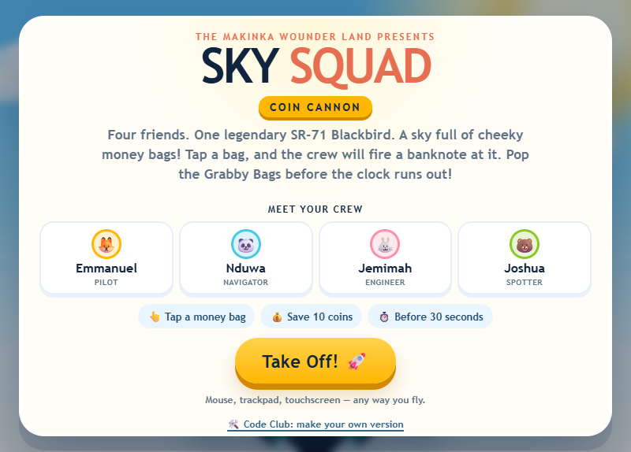

# The Makinka Wounder Land: Sky Squad — Coin Cannon

A tiny browser game starring **Emmanuel, Nduwa, Jemimah, and Joshua** in their SR-71 Blackbird.

Tap the flying money bags. The crew fires money at them, and you collect coins. Save 10 coins before the 30-second clock runs out.

No installs, no internet, and no accounts are needed.

## Play

Double-click **`index.html`**.

Works with a mouse, trackpad, or touchscreen. Use Chrome, Edge, or Firefox for the best experience.

## Learn to code

Open **`learn.html`** for the four-mission Code Club Flight Manual. It is written for a Grade 3 pilot working with a grown-up co-pilot.

The club is a guided remix of a real, working game:

1. **Make the crew yours** — edit HTML/JavaScript data.
2. **Tune the mission** — change variables and test game balance.
3. **Add a golden money bag** — use HTML attributes and JavaScript math.
4. **Remix and debug** — change the game, then find and fix a deliberate bug.

Use **`my-game.html`** as the child's editing copy. **`index.html`** is the original answer key, so it is always safe to compare against or restore from.

> Important: edit code in Notepad, Notepad++, VS Code, or another plain-text editor — not Microsoft Word.

After each change: **save** (`Ctrl+S`), then **refresh** the browser (`Ctrl+R` or `F5`).

## Files

| File | Purpose |
| --- | --- |
| `index.html` | The finished game. Double-click to play. |
| `my-game.html` | A working copy for Code Club edits. |
| `learn.html` | The illustrated, printable Code Club manual, including the certificate and grown-up notes. |
| `screenshot.png` | Preview image for this README. |
| `README.md` | This quick-start guide. |

## For the grown-up co-pilot

- Four sessions of about 20–30 minutes is a comfortable pace.
- The goal is not to type every line from scratch. It is to read real code, change data, trace a click, use variables, and debug. That is how real game makers learn a codebase.
- Let the child make choices and press the keys. Ask “What do you think will happen?” before each test.
- The finished game is the answer key. If an edit breaks something, undo with `Ctrl+Z` or compare with `index.html`.
- No personal data is collected and nothing is saved online.

## Quick things to change

While playing, the game reads its crew and settings from the top of the script in `index.html` / `my-game.html`:

- `CREW` — names, roles, emoji, and flight colors.
- `GAME_SECONDS` — how long a round lasts.
- `BAGS_TO_WIN` — how many coins are needed to win.
- `CHEERS` — the lines the crew says after a hit.

Look for the big `SECTION` comments in the code. The manual explains each one.

## Troubleshooting

- **Nothing happens after an edit** — make sure you saved the file and refreshed the browser.
- **The page is blank** — a quote, comma, or bracket is probably missing. Undo your last change and compare with `index.html`.
- **The game is too easy or too hard** — change `GAME_SECONDS` or `BAGS_TO_WIN`, or adjust the golden bag's points in the HTML.
- **The golden bag is not gold** — its class must be exactly `bag golden`, and its bonus must be `data-points="3"`.

Have a wonderful flight. 🚀
